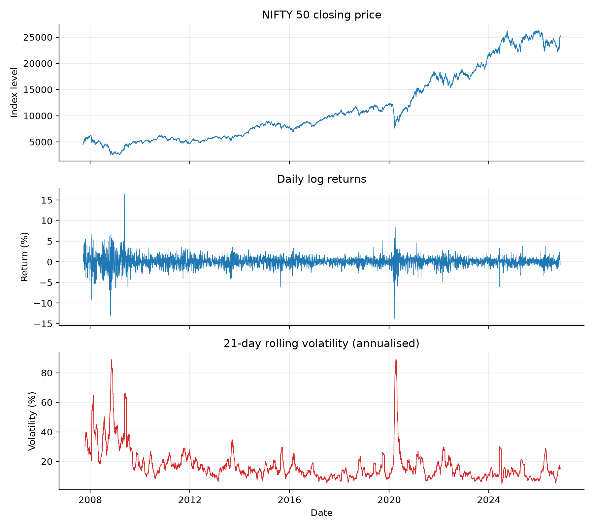
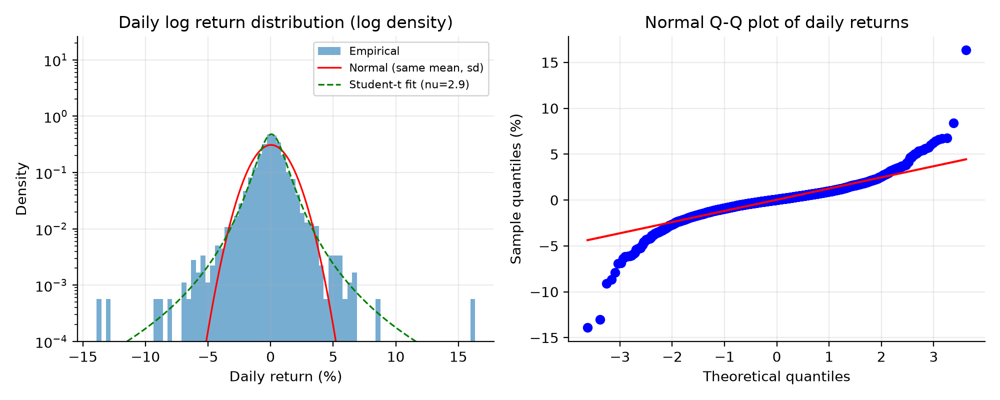
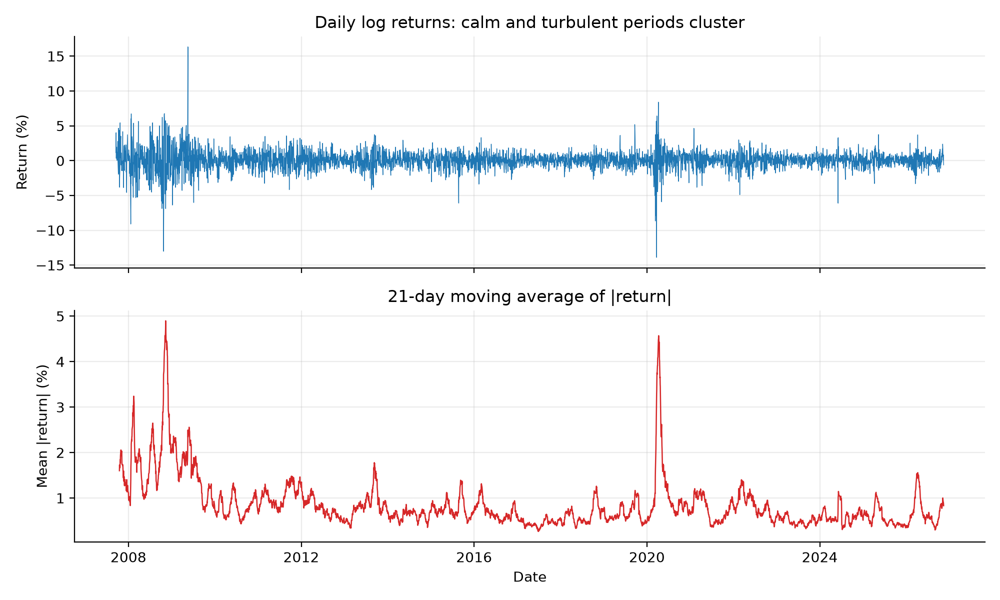
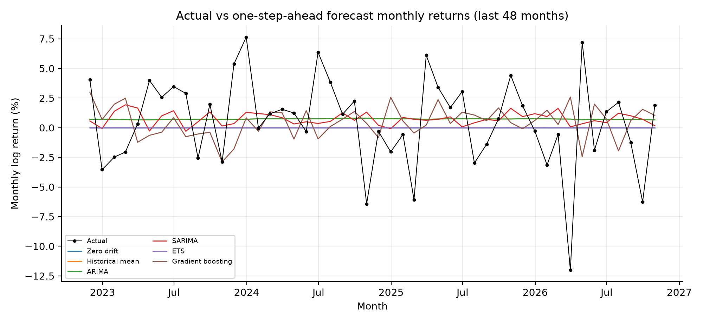
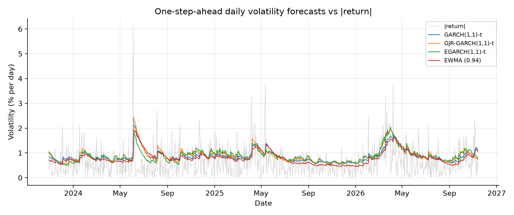
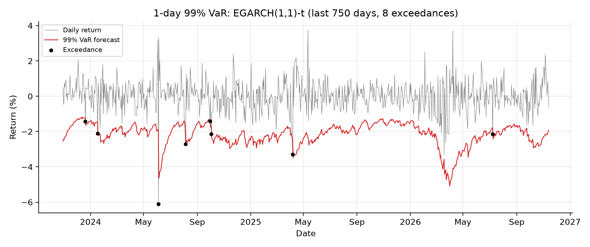

# Forecasting and Volatility Analysis of the NIFTY 50


A reproducible time-series study of India's NIFTY 50 index, built to answer two questions honestly rather than to "beat the market". **Headline result:** monthly returns were not forecastable beyond a constant mean, but daily volatility and tail risk were (see section 8).

## 1. Project overview

The project forecasts the NIFTY 50 in two ways and tests each claim statistically:

1. **Monthly return forecasting:** do ARIMA, SARIMA, ETS or gradient boosting predict next month's return better than a no-skill baseline?
2. **Daily volatility forecasting and risk:** do GARCH-family models forecast volatility and Value-at-Risk better than simple EWMA and rolling-window estimators?

What it demonstrates is the evaluation discipline: strictly out-of-sample, expanding-window forecasts; model orders chosen only on the first training window; every fallback and failure counted; and formal tests (Diebold-Mariano, Kupiec, Christoffersen) instead of eyeballed accuracy tables.

## 2. Research questions

- **RQ1.** Does any model beat the zero-drift and expanding-historical-mean baselines for monthly returns, in squared error and direction, and is the difference statistically significant after multiple-testing adjustment?
- **RQ2.** Are NIFTY 50 returns stationary and do they show volatility clustering (ADF, KPSS, Ljung-Box, ARCH-LM)?
- **RQ3.** Do asymmetric, fat-tailed GARCH models (GJR, EGARCH, Student-t) forecast volatility (QLIKE) better than EWMA (lambda = 0.94) and a rolling 250-day variance?
- **RQ4.** Which models produce 95% and 99% VaR forecasts that pass Kupiec, independence and conditional-coverage backtests?

## 3. Dataset and source

Daily NIFTY 50 closing prices, Yahoo Finance ticker `^NSEI` (unadjusted close), downloaded on 2026-11-13: 4,700 observations from 2007-09-17 to 2026-11-13. The run records the exact series used (`results/nifty_close_used.csv`) and a data-quality report (`results/data_validation.json`). No missing values, duplicate dates or non-positive prices were found, and dates are in chronological order. Non-trading days are not filled; returns are between consecutive trading days.

Two flagged observations were reviewed and retained: one weekend date (Saturday 2025-02-01, consistent with the Union Budget special trading session; not independently verified) and one 6-day calendar gap (October 2014, consistent with a holiday closure). The last observation (2026-11-13) was downloaded on the same day and may be a provisional intraday value if the download ran before the market close; re-running after the close gives the final figure and is not expected to change conclusions. If Yahoo is unavailable, supply a `Date,Close` CSV with `--csv`. The pipeline never substitutes synthetic data for results.

## 4. Statistical methodology

- Log returns r_t = 100 * (ln P_t - ln P_{t-1}), daily; monthly returns from month-end closes (a partial trailing month is dropped).
- Stationarity: ADF and KPSS on log prices and returns, reported together with a combined verdict. Distribution: skewness, excess kurtosis, Jarque-Bera, histogram/density, Q-Q plot. Dependence: ACF/PACF, Ljung-Box on returns, squared returns and absolute returns, ARCH-LM at several lags.
- Residual diagnostics for ARIMA, SARIMA and the best GARCH model (in-sample, full-sample fits; used for diagnosis only, never for forecast evaluation).

## 5. Forecasting framework (monthly)

Expanding window, one step ahead, first training window of 96 months, parameters re-estimated at every origin.

| Model | Specification |
|---|---|
| Zero drift | forecast 0 |
| Historical mean | mean of all earlier returns |
| ARIMA | (p,0,q), p,q <= 2, with constant; order by AIC on the first window only (selected: (0,0,0)) |
| SARIMA | adds (P,0,Q,12); order by AIC on the first window only (selected: (0,0,0)x(1,0,1,12)) |
| ETS | additive-error exponential smoothing on log price, form by AIC on first window (selected: ETS(A,N,N)); forecast converted to a return |
| Gradient boosting | 6 lags, rolling means/std, month-of-year terms; 95% intervals from 2.5%/97.5% quantile models |

Metrics: MAE, RMSE, out-of-sample R-squared vs the historical mean, directional accuracy (undefined for zero drift), 95% interval coverage, mean width, Winkler score. Pairwise Diebold-Mariano tests on squared error with Newey-West variance (lag floor(n^(1/3))) and the Harvey-Leybourne-Newbold small-sample correction, with Holm adjustment across pairs. Statistical significance is reported separately from the size of the improvement.

## 6. Volatility modelling framework (daily)

GARCH(1,1), GJR-GARCH(1,1) and EGARCH(1,1) with Student-t innovations and a constant mean, re-estimated every 21 trading days on data strictly before each block, one-step-ahead variance forecasts with parameters held fixed inside a block. Baselines: EWMA (lambda = 0.94) and rolling 250-day variance. If a re-estimation fails, the last successful parameters are reused and the event is logged in `results/fallback_events.csv`; optimiser non-convergence is logged too (none occurred in the reported run).

Squared returns are the variance proxy. They are unbiased but extremely noisy, so absolute loss levels are not meaningful; QLIKE is used because it ranks forecasts consistently under that noise (Patton, 2011). Intraday realised variance would be a better proxy but is not available here.

## 7. Evaluation metrics

QLIKE, variance MSE and sigma-vs-|r| MAE; pairwise DM tests on QLIKE; 95% and 99% one-day VaR with the Kupiec unconditional-coverage test, the Christoffersen independence test and the combined conditional-coverage test. Baseline VaR uses a normal quantile while GARCH-family VaR uses the fitted t, so VaR differences mix variance and tail assumptions.

## 8. Actual numerical findings

**Run:** NIFTY 50 (`^NSEI`), 2007-09-17 to 2026-11-13: 4,700 daily closes, 4,699 daily returns, 229 monthly returns. Out-of-sample: **133 monthly forecasts (October 2015 to October 2026)** and **3,199 daily forecasts (November 2013 to November 2026)**. There were no GARCH fallback events and no monthly model-fit failures or statsmodels warnings.

**Diagnostics (RQ2).**
- Log prices are non-stationary (ADF p = 0.93 daily, 0.90 monthly; KPSS rejects at 1%). Daily and monthly log returns are stationary (ADF p < 0.001; KPSS does not reject; KPSS p-values are truncated at the table bounds of 0.01 and 0.10).
- Daily returns: mean 0.037%, standard deviation 1.29%, skewness -0.28, excess kurtosis 15.2 (Jarque-Bera p ≈ 0): strongly fat-tailed.
- Volatility clustering is strongly supported: Ljung-Box on squared and absolute returns (lags 5, 10, 20) and ARCH-LM (lags 5, 10, 20) all give p < 0.001. Returns themselves show only small linear autocorrelation (Ljung-Box(10) p = 2.5e-5).

**Monthly return forecasting (RQ1): no model beat the historical-mean baseline.**
- The historical mean has the lowest RMSE (4.747). No model differs significantly from it (unadjusted DM p ≥ 0.063), and **0 of 15 pairwise comparisons are significant after Holm adjustment**.
- ARIMA's first-window AIC selected (0,0,0) with a constant, which *is* the historical mean (identical forecasts, p = 1.0); it is a model-selection result, not independent evidence. SARIMA (+1.3% RMSE) and ETS (+1.0%) are slightly worse. Gradient boosting is clearly worst (RMSE 5.579, +17.5%, OOS R² = -0.38), though unadjusted p = 0.063 is not significant.
- The historical mean's 57.1% directional accuracy equals the share of up-months in the test window (57.1%): it always forecasts "up", so this reflects the market's upward drift, not skill. No model shows directional skill.
- 95% intervals from the baselines and ARIMA-type models over-cover (97.7% versus the 95% target, i.e. too wide); gradient boosting's quantile intervals are much narrower (mean width 15.5 versus 25.6) with 94.0% coverage.
- Reading: with ~133 forecasts power is limited, so this is evidence that these models add no detectable value over a constant mean, not proof of market efficiency.

**Volatility forecasting (RQ3): GARCH-family models beat the simple baselines.**
- QLIKE (lower is better): EGARCH-t 0.7093, GJR-GARCH-t 0.7102, GARCH-t 0.7279, EWMA 0.7498, rolling 250-day 0.9241.
- Each GARCH-family model beats both EWMA and the rolling window in pairwise DM tests on QLIKE (Holm-adjusted p = 0.035 to 0.036). The three GARCH models cannot be told apart (Holm p ≥ 0.36), so no winner among them is claimed. EWMA versus rolling window is borderline (Holm p = 0.054).
- Full-sample fits show fat tails (Student-t ν ≈ 7.2 to 7.6) and a leverage effect (GJR γ = 0.129; EGARCH γ = -0.090): negative shocks raise volatility more than positive ones.

**Value-at-Risk (RQ4).**
- **99% VaR:** GARCH-t, GJR-GARCH-t and EGARCH-t are not rejected (exceedance rates 1.22%, 1.06%, 1.13%; conditional-coverage p = 0.39 to 0.65). EWMA (1.88%, p = 0.0001) and the rolling window (1.78%, p < 0.0001) are rejected as too risky.
- **95% VaR:** the three GARCH models and EWMA are not rejected; the rolling window is rejected (conditional-coverage p = 0.003), mainly because its exceedances cluster (independence p = 0.0008).
- Caveat: EWMA and rolling-window VaR use normal quantiles while GARCH uses the fitted Student-t, so the VaR gap mixes the variance forecast with the tail assumption.

**Model adequacy (in-sample).** ARIMA residuals show no autocorrelation (Ljung-Box p = 0.46 to 0.70; ARCH-LM(6) p = 0.061); SARIMA residuals show mild ARCH effects (p = 0.016). For EGARCH, squared standardised residuals are clean (Ljung-Box(10) p = 0.12, (20) p = 0.33; ARCH-LM(10) p = 0.105), so the variance dynamics are adequately captured; however the standardised residuals retain some serial correlation (Ljung-Box p < 0.01), because the mean equation is only a constant.

**What this demonstrates:** over this sample, next-month NIFTY 50 returns were not predictable by ARIMA, SARIMA, ETS or gradient boosting beyond a constant mean, while next-day volatility and tail risk were: asymmetric, fat-tailed GARCH models produced better variance forecasts and the only VaR forecasts that passed the 99% backtests.

The tables below are generated by the pipeline (`python -m src.run_all --data nifty`) and are replaced on each run.

<!-- RESULTS:START -->
_Auto-generated by `src.run_all` from NIFTY 50 (^NSEI, Yahoo Finance), 2007-09-17 to 2026-11-13: 4700 daily prices, 229 monthly returns, 133 monthly and 3199 daily out-of-sample forecasts._

**Monthly return forecasts (one step ahead, expanding window)**

| model             |   RMSE |    MAE |   OOS R2 vs hist. mean |   Directional acc. |   95% coverage |   DM p vs hist. mean |
|:------------------|-------:|-------:|-----------------------:|-------------------:|---------------:|---------------------:|
| Zero drift        | 4.7943 | 3.4798 |                -0.0200 |           nan      |         0.9774 |               0.3040 |
| Historical mean   | 4.7472 | 3.4279 |                 0.0000 |             0.5714 |         0.9774 |             nan      |
| ARIMA             | 4.7472 | 3.4279 |                 0.0000 |             0.5714 |         0.9774 |               1.0000 |
| SARIMA            | 4.8097 | 3.5053 |                -0.0265 |             0.5263 |         0.9774 |               0.2703 |
| ETS               | 4.7952 | 3.4801 |                -0.0203 |             0.4737 |         0.9774 |               0.2992 |
| Gradient boosting | 5.5788 | 3.9542 |                -0.3810 |             0.4812 |         0.9398 |               0.0633 |

**Daily volatility forecasts**

| model            |   QLIKE |   MSE (variance) |   MAE (sigma vs |r|) |
|:-----------------|--------:|-----------------:|---------------------:|
| GARCH(1,1)-t     |  0.7279 |          18.7165 |               0.5424 |
| GJR-GARCH(1,1)-t |  0.7102 |          18.5932 |               0.5442 |
| EGARCH(1,1)-t    |  0.7093 |          17.7499 |               0.5315 |
| EWMA (0.94)      |  0.7498 |          19.1185 |               0.5260 |
| Rolling 250d     |  0.9241 |          21.4316 |               0.5847 |

**VaR backtests (p-values)**

| model            | VaR level   |   Exceedances |   Violation rate |   Kupiec p |   Independence p |   Cond. coverage p |
|:-----------------|:------------|--------------:|-----------------:|-----------:|-----------------:|-------------------:|
| GARCH(1,1)-t     | 99%         |            39 |           0.0122 |     0.2285 |           0.5014 |             0.3863 |
| GARCH(1,1)-t     | 95%         |           181 |           0.0566 |     0.0941 |           0.3788 |             0.1672 |
| GJR-GARCH(1,1)-t | 99%         |            34 |           0.0106 |     0.7237 |           0.3926 |             0.6519 |
| GJR-GARCH(1,1)-t | 95%         |           156 |           0.0488 |     0.7477 |           0.3827 |             0.6487 |
| EGARCH(1,1)-t    | 99%         |            36 |           0.0113 |     0.4848 |           0.3653 |             0.5200 |
| EGARCH(1,1)-t    | 95%         |           155 |           0.0485 |     0.6865 |           0.8531 |             0.9061 |
| EWMA (0.94)      | 99%         |            60 |           0.0188 |     0.0000 |           0.9021 |             0.0001 |
| EWMA (0.94)      | 95%         |           184 |           0.0575 |     0.0565 |           0.6510 |             0.1464 |
| Rolling 250d     | 99%         |            57 |           0.0178 |     0.0001 |           0.0211 |             0.0000 |
| Rolling 250d     | 95%         |           151 |           0.0472 |     0.4638 |           0.0008 |             0.0028 |

Full tables, tests, and interpretation: [`results/REPORT.md`](results/REPORT.md).
<!-- RESULTS:END -->

## 9. Visualizations

All figures are in [`results/figures/`](results/figures/). Selected:








The full set also includes monthly returns, ACF/PACF (daily and monthly), 95% prediction intervals (best model and all models), cumulative squared-error advantage over the benchmark, RMSE comparison, ARIMA/SARIMA/GARCH residual diagnostics, GARCH conditional volatility and the 95% VaR exceedance plot.

## 10. Limitations

- One index, one sample period; results may not transfer to other markets or regimes.
- ARIMA/SARIMA/ETS orders are chosen once on the first window and then frozen; the selected ARIMA is the historical mean, so it adds no independent comparison.
- About 133 monthly forecasts give limited power: "not significant" is not "equally good".
- Many pairwise tests: rely on Holm-adjusted p-values.
- GARCH parameters are re-estimated every 21 days, not daily, and use a constant mean, which leaves some serial correlation in the standardised residuals.
- Squared returns are a noisy volatility proxy.
- VaR baselines use normal quantiles while GARCH uses Student-t, so VaR comparisons are not purely about the variance forecast.
- Monthly prediction intervals are conservative (97.7% coverage versus 95%).
- Residual diagnostics are in-sample. Nothing here is investment advice.

## 11. Installation and execution

Requires Python 3.11 or newer (tested on 3.12 in development and 3.14 for the reported run).

```bash
python -m venv .venv && source .venv/bin/activate     # Windows: .venv\Scripts\Activate.ps1
pip install -r requirements.txt
python -m pytest -q                                   # 21 unit tests (synthetic data, no network)
python -m src.run_all --data nifty --out results      # downloads ^NSEI, runs everything (~10-20 min)
# or, offline: python -m src.run_all --data nifty --csv data/nifty.csv --out results
```

`./reproduce.sh` does all of the above in a fresh environment. Results depend on the download date, because Yahoo's history is extended daily. Never report output from `--data synthetic`; that mode exists only to test the code.

## 12. Repository structure

```
.github/workflows/ci.yml   tests on Python 3.11 and 3.12
src/data.py                download/CSV loading, validation, return construction
src/stats_tests.py         ADF, KPSS, Ljung-Box, ARCH-LM, clustering tests
src/mean_models.py         baselines, ARIMA, SARIMA, ETS, gradient boosting, rolling-origin loop
src/volatility.py          GARCH family, EWMA, rolling window, fallback logging
src/metrics.py             accuracy, intervals, Diebold-Mariano, QLIKE, VaR backtests
src/plots.py               figures
src/run_all.py             pipeline, statistical_tests.csv, REPORT.md, README results block
tests/                     returns, alignment, look-ahead, metrics, data validation, end-to-end
results/                   generated outputs (CSVs, REPORT.md, figures/)
docs/                      completion-report template
reproduce.sh               fresh-environment reproduction
```
